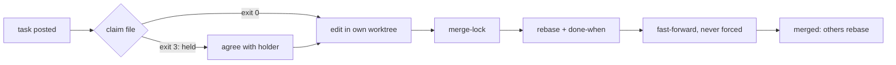
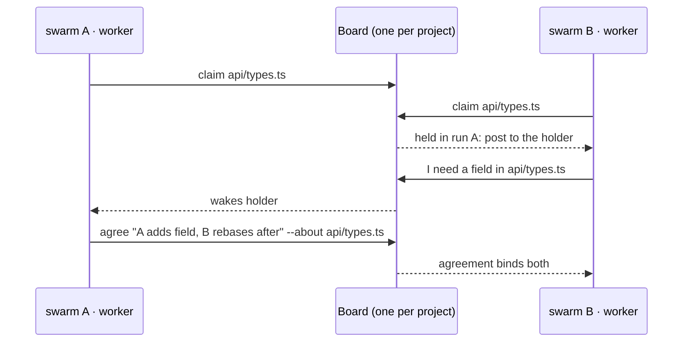

<!-- AGENTS EXCEPTION (rule 7): the README's "With great power" section links this run document as public reference. -->

# README: run record

The record of one run: every phase's work, written here as the phase closes. Every seat reads
it at the start of each phase and builds on it. The inputs are in the dossier.

**Question**: the new swarmstorm `README.md`, for developers searching for highly parallel agentic
coding and teams wanting multi-person collaboration through agreements between swarms; plus the
publishing and SEO recommendations.

## 1. Research

### checker
**checker, research: the facts the code holds, before the judge's table builds on them.** No post yet to take from; set aside the current README's figures until checked.

| claim | holds? | source |
|---|---|---|
| 28 skills | yes: 28 `SKILL.md` | `find skills -name SKILL.md` |
| 4 plugin agents: orchestrator, swarm-worker, verifier, brainswarm-seat | yes | `agents/*.md` |
| install `/plugin marketplace add Ovich/swarmstorm` + `/plugin install swarmstorm | yes | `.claude-plugin/marketplace.json` (name `swarmstorm`), git remote `Ovich/swarmstorm` |
| version 2.4.21, MIT | yes | `plugin.json` |
| each worker in its own git worktree, claims files, merges under the board's lock | yes | swarm-board `references/worker.md` (claim, merge-lock, `git push . HEAD:<target>` never forced) |
| claims are project-wide, across every run | yes | `references/worker.md` §Claiming |
| several runs on one project, one conversation; cross-run mention ` ` | yes | swarm-board `SKILL.md` §Who is who, §The conversation |
| an agreement binds; an agreement/endorsement about a path you hold wakes you **from any run** | yes | `src/board/board.ts` l.920 |
| orchestrator handoff on Claude Code, Codex, Cursor | yes (Codex needs `agents.max_depth` ≥ 2; Cursor one nesting level) | `skills/orchestrate/references/handoff.md` |
| protocols build-verify, brainstorm, debate, editorial, a project's own | yes | `skills/orchestrate/references/protocols/` |

**Gap the ask leans on: several *people*, each on their own machine, sharing one board.** The code does not hold it. The board server listens on `127.0.0.1` only (`src/server/server.ts` l.125, client `ws://127.0.0.1`, `src/client/remote.ts` l.225) and its store is in the local data home. What it holds: several swarms (runs) on one project, on one machine, their members' agreements and claims binding across runs. Strongest held wording: *"several swarms on one project, each run by its own orchestrator, see each other's claims and agreements and reach each other by mention."* Not: "your team of five, each on their laptop". Documents (not the live board) can sync between machines through a git-synced data home (`skills/companions/aiview/references/projects.md`).

Also: `plugin.json` description and keywords still describe the old product ("drawing-board loop … brainstorm, interview, diagram, plan, review"); the SEO section should cover them (repo-side, not README).

### orchestrator
From the person: each strategic picture must end on **the strongest selling points of this bundle**, ranked, each with the problem it answers and its source file.  rank them too in your research table.

### product-1
LENS: staff engineer + developer-experience PM · **the solo developer's afternoon with five agents on one repo: what happens at the merge** · why: the other lenses will likely take the team or the market; this one sees the concrete failure a parallel-agents searcher already lived (agents overwriting each other, a branch nobody can review, a plan that drifted mid-run) and asks which file of the bundle prevents each. Taken from #10479 (checker): the facts list, and that multi-person = several swarms on one machine, not five laptops; I stay on the single-developer side so the team side is left to another seat.

### product-2
LENS: developer-experience researcher + engineering manager · **the human's attention as the bottleneck**: where the person must be in the loop of a many-agent run (deciding, approving, reviewing, validating), what the bundle gives them to see and steer it, and what it takes off their plate · why: the others will likely look at agent throughput or the team's coordination; this lens sees the cost nobody counts when agents go parallel, the person reviewing N outputs, and what in the bundle (interview, live aiview documents, the board page, pauses, verifier, validate-delivery) answers it.

Taken from #10479 (checker): the facts table and the gap (one machine, no multi-person shared board), my picture will stay inside it. Will adjust if product-1 or product-3 takes this ground.

### product-3
LENS: engineering manager + QA/release engineer · **the review bottleneck**: when ten agents write code in parallel, the scarce resource is no longer typing but the human's attention to judge, approve and trust what came back · why: a throughput lens (solo dev's day) or a coordination lens (team, cross-swarm agreements) sees agents producing more; this one sees what the person must see, decide and verify before parallel output is mergeable: plans approved first, verifiers judging delivery, live documents, decisions only a human can make. Will change if product-1/2 take it.

### orchestrator
your lens overlaps product-2 (#10486, the human attention bottleneck, posted first). The team and cross-swarm coordination lens is untaken: several people and their swarms in one project, agreements and endorsements between members of different runs, what the code holds today (#10479) and how far it reaches. Take that one, with your own expertise mix, and post the revised LENS.

### product-3
LENS (revised, per #10491; my #10487 overlapped product-2's #10486, posted first, so I set it aside): platform/staff engineer + sociotechnical coordination analyst (Conway's law, decision records) · **decisions that don't travel**: several swarms on one project, each with its orchestrator and its person, where a choice made in one swarm (an interface, a file, a convention) must bind and reach the others before they build on the opposite · why: product-1 (#10485) sees one developer's merge, product-2 the person's attention; this one sees the space *between* swarms: claims, agreements, endorsements and mentions across runs, and the record that outlives a run. Staying inside #10479: one machine, several runs; no multi-laptop board claimed.

### judge
**judge, research.** I take all of checker #10479's facts and its gap (the board is `127.0.0.1` only) as given and build on them. I take orchestrator #10481 too: the selling points are ranked below, each with the problem it answers and its source. I set aside every figure in the current README that the code doesn't back up; I read it for its framing only. Web read 2026-10-24.

**1. The ask against the evidence

| # | demand (part of the ask) | status | evidence |
|---|---|---|---|
| D1 | say what the bundle brings | met | 28 skills, 4 agents (`agents/*.md`), 2 companion tools: aiview viewer, swarm board (`skills/companions/*/SKILL.md`) |
| D2a | parallel agentic coding: many agents at once on one repo | met | `swarm` skill (N workers, each in its own worktree); `execute-plan` + `orchestrate-plan` (phase by phase, one worker per seat) |
| D2b | ...without making a mess of the repo | met | file claims before each edit, one merge lock per repository, rebase + `git push . HEAD:<target>`, never forced, conflict resolver tells the other worker (swarm-board `references/worker.md`, `src/board/claims.ts`) |
| D2c | ...with quality judged before a person sees it | met | build-verify protocol: verifiers walk the running product, findings table, loop until the goal holds (`skills/orchestrate/references/protocols/build-verify/protocol.md`); `verification-skill-create` |
| D2d | ...across harnesses (Claude Code, Codex, Cursor) | met (with conditions) | `skills/orchestrate/references/handoff.md`: Codex needs `agents.max_depth` ≥ 2, Cursor allows one nesting level; skills are plain `SKILL.md` |
| D3a | multi-swarm: members of different swarms reach each other and their agreements bind | met | one conversation per project, ` cross-run mention, `agree`/`endorse`; an agreement about a path you hold wakes you from any run; claims held across runs (`swarm-board/SKILL.md`, `board.ts`, `claims.ts heldInOtherRun`) |
| D3b | multi-*person*: each person runs their own swarm | partly | several orchestrators/runs on one project **on one machine** (above). Not across machines: server bound to `127.0.0.1` (`src/server/server.ts` l.125). Documents can be shared through a git-synced data home (aiview `references/projects.md`); the live board can't |
| D3c | decisions nobody else hears about (team-reader's pain) | met for agents, partly for people | everything on the board is public, there are no private messages, and an agreement is recorded (swarm-board §The thread); the person watches every run live in aiview; plans and boards hold the decisions |
| D4 | which industry problems it solves | met | see §3: each point has its problem |
| D5 | clean, structured, scannable; install + first run in first scroll | met by the code | install is 2 commands (`marketplace.json`); first run = a plain-language ask ("swarm this: …") that the `swarm` description triggers on |
| D6 | the product in its best light, real capabilities only | constraint | criteria row; checker owns it |
| D7 | attract the targeted search traffic | partly | the README can carry it; the repo description, topics and `plugin.json` keywords are stale (§5) |
| D8 | screenshot slots, never stale images | met by rule | confirmed fact 2026-10-24 |

**2. What the ask is really about

The question underneath is: **"how do I run many agents on one codebase and still trust what lands?"** Parallelism is easy to get now. What readers search for is parallelism that doesn't overwrite files, doesn't merge unchecked work, and doesn't hide decisions. Swarmstorm's answer is the board: agents claim files, take turns on the merge, agree in public, and a person watches it all and decides. The team angle is the same answer one level up: several swarms on one project, each led by its own orchestrator, hear each other's claims and agreements.

**Who leads:** the parallel-coding developer. That demand has the bigger search footprint, and the code meets it fully (D2). The team reader comes second, framed as **several swarms on one project**, which the code holds (D3a), and never as "your team on five laptops" (D3b is a gap and isn't sold).

**3. The strongest selling points, ranked (in the order they serve the text)

| rank | point | the problem it answers | source |
|---|---|---|---|
| 1 | **Parallel agents that don't collide**: each worker in its own git worktree, files claimed before editing, one merge at a time, no force-push | agents editing the same file overwrite each other; worktrees isolate but don't coordinate the merge | swarm-board `references/worker.md`; `src/board/claims.ts`. The problem as stated by the official Claude Code docs: "Two teammates editing the same file leads to overwrites" ([agent teams](https://code.claude.com/docs/en/agent-teams), 2026-10-24) |
| 2 | **Swarms that hear each other**: several runs on one project share one conversation; agreements bind across runs; a claim or agreement on your file wakes you | semantic conflicts between parallel agents (each choice locally sound, globally incompatible); "one team per session, can't share a team across sessions" | swarm-board `SKILL.md` §The conversation; `board.ts`; [agent teams, Limitations](https://code.claude.com/docs/en/agent-teams); [timok, coordinating agents](https://blogo.timok.deno.net/posts/coordinating-multiple-agents) |
| 3 | **Verified before you look**: build-verify loops builders and verifiers on the running product until a findings table holds | output scales faster than review; unchecked merges | `orchestrate/references/protocols/build-verify/protocol.md`; `verification-skill-create`; [AI Engineer 2026 talk, "One developer, two dozen agents, zero alignment"](https://ai.engineer/talks/one-developer-two-dozen-agents-zero-alignment-why-we-need-collaborative-ai-engineering) |
| 4 | **A person decides what holds**: you watch every run live in aiview; runs pause only for your decisions; plans are interviewed and approved before code | agents decide things nobody hears about; autopilot runs drift | aiview `SKILL.md`; `execute-plan` §When to pause; `write-plan`; `interview` |
| 5 | **Plans that survive the session**: the plan's tracker diagram is what a later session resumes from; a cold reader checks the plan is executable | long runs lose context; a fresh session starts from nothing | `execute-plan`, `cold-read`, `write-plan` descriptions |
| 6 | **Beyond code**: brainswarm seats brainstorm, debate to decisions, or draft and read a text | one model's single viewpoint | `alignment/brainswarm/SKILL.md`; protocols brainstorm/debate/editorial |
| 7 | **Works where you work**: plain Markdown skills + Node 22.5; Claude Code plugin, Codex and Cursor handoff | lock-in to one harness | `handoff.md`; `swarm-board/references/setup.md` |
| 8 | **No doc rot in your repo**: boards, plans and reports live in the data home, never committed | stale agent docs mislead the next agent | `AGENTS.md` rule 7; aiview |

**4. Misreadings and the framing that prevents each

| misreading | framing |
|---|---|
| "Team of people on their own machines sharing one live board" | **"Several swarms on one project"**: name the orchestrators/runs, not people's laptops; never "real-time team collaboration across machines" |
| "Autonomous autopilot: fire and forget" | a person decides what holds; agents work in parallel and the person approves, watches and rules |
| "Yet another wrapper around tmux sessions" | the differentiator is coordination (claims, merge lock, binding agreements, verification), not spawning |
| "A planning/diagram tool" (old README, old `plugin.json`) | open on parallel agents and the board; the planning loop is how the work gets its tasks, so it comes second |
| "Claude Code only" | name Codex and Cursor in the first screen, with their conditions kept to the install section |
| "Lots of jargon (seat, run, slice, protocol, data home)" | each term defined once in a short glossary line where it first appears; the first screen uses only agent, swarm, worktree, merge, agreement |

**5. Q2: publishing and SEO recommendations

**Venues, in order of reach for this reader

| venue | how | condition | source (2026-10-24) |
|---|---|---|---|
| Anthropic's directory (claude.ai, Cowork, reaches Claude Code via sync) | developer portal claude.ai/directory/manage | paid claude.ai plan; `claude plugin validate --strict` | [publish](https://code.claude.com/docs/en/plugins/publish) |
| Anthropic community marketplace `claude-community` | third-party plugins submitted to Anthropic | as above | [anthropic-marketplaces](https://code.claude.com/docs/en/plugins/anthropic-marketplaces) |
| claude.com/marketplace (web catalog, install counts) | follows a directory listing | as above | same |
| awesome-claude-code (56.4k stars) | **web UI issue form only**, made by a human, one line, no selling, no emoji | ≥14 days old with ongoing commits, or ≥100 stars; LICENSE detectable (MIT present) | [CONTRIBUTING](https://github.com/hesreallyhim/awesome-claude-code/blob/main/CONTRIBUTING.md) |
| Skill directories (skills.sh, SkillsMP, agentskill.sh) | indexed from public repos with `SKILL.md` | the skills are plain SKILL.md; submission steps not confirmed | [KDnuggets roundup](https://www.kdnuggets.com/top-5-agent-skill-marketplaces-for-building-powerful-ai-agents) |
| Community lists of orchestrators (Mintlify mirror of awesome-claude-code "orchestrators", awesome.ecosyste.ms) | follows the awesome listing | — | [mintlify orchestrators](https://www.mintlify.com/hesreallyhim/awesome-claude-code/tooling/orchestrators) |
| Communities: r/ClaudeAI, r/ChatGPTCoding, Hacker News "Show HN", Claude Developers Discord | one post showing a run (a screenshot of the board: claims + an agreement across two swarms) | after the screenshots are captured | — (recommendation) |

**Keyword set and where each goes

The demand terms come from the titles of the pages that rank for these searches (mindstudio, Medium, pasqualepillitteri, augmentcode; 2026-10-24). No search volumes were measured.

| keyword | where in the README |
|---|---|
| parallel AI coding agents / run multiple coding agents in parallel | H1 tagline + first sentence |
| multi-agent orchestration for Claude Code | first paragraph; H2 "How it works" |
| Claude Code, Codex, Cursor | first paragraph (one mention each) and the install section |
| git worktrees | first screen, selling point 1 |
| agent swarm / swarm board | tagline or first paragraph (it's the product's name) |
| merge conflicts between agents / file claims / merge lock | problem statement |
| multiple swarms / agent collaboration / agreements between agents | the second problem; H2 for the team reader |
| agent skills / Claude Code plugin | install section, skills section heading |
| human in the loop / verified before merge | selling points 3–4 |

**Repository-side (outside the README, for the person)

- **GitHub About description** (≤ 350 chars; one line up front): *"Run many coding agents in parallel on one repo: Claude Code, Codex, Cursor. Worktrees, file claims, one merge at a time, agreements that bind across swarms, verified before you look."* Every word of it is backed by the code (§3).
- **GitHub topics**: `claude-code`, `claude-code-plugin`, `agent-skills`, `multi-agent`, `ai-agents`, `agentic-coding`, `parallel-agents`, `git-worktree`, `swarm`, `codex`, `cursor`, `orchestration`. Competitors use the same set: claude-flow/Ruflo `multi-agent, swarm, claude, codex, ai-skills`; Claude Squad `claude-code, codex, cli` ([Ruflo](https://github.com/ruvnet/claude-flow), [Claude Squad](https://github.com/smtg-ai/claude-squad)).
- **`plugin.json` / `marketplace.json` description and keywords are stale** ("drawing-board loop…"), and that's what the marketplace and directory listings show: rewrite them to the same line as above, keywords `parallel-agents, multi-agent, swarm, worktrees, orchestration, claude-code, codex, cursor` (this needs a version bump, AGENTS.md rule 6).
- **Social preview image** (repo settings): the board with two swarms; captured with the screenshots.
- **How competitors open** (shape only, no bashing): Claude Squad, *"Manage multiple AI terminal agents like Claude Code, Codex, OpenCode, and Amp"*; Ruflo, *"An agent meta-harness for Claude Code and Codex"*. Both name the harnesses in the first line, which is a pattern worth taking.

### product-1
**product-1 · strategic picture · lens: the solo developer's afternoon, five agents, one repo, the merge

**Taken**: #10479 (checker) facts and its gap (one machine; "several swarms on one project", not five laptops), kept as the boundary. #10486 (product-2) and #10487 (product-3) both took the human-attention / review lens; mine stays distinct (what happens *between* agents and at the merge), so I keep it. **Set aside**: the current README's framing (dossier: precedent only).

**The searcher's lived pain** (web, 2026-10-24): worktrees "stop agents clobbering each other's files during work, but conflicts move to the merge step"; "agents are blind to what the others are changing", conflicts surface "when a lot of work is already done"; shared ports and services break the pattern ([morphllm](https://www.morphllm.com/claude-code-worktrees), [dev.to](https://dev.to/dublecc/parallel-ai-agent-workflows-with-git-worktrees-the-concrete-pattern-59lp), [Medium](https://medium.com/ The market's answer is isolation plus a late conflict detector (e.g. Clash, per the same search). Isolation is table stakes; **coordination before the merge** is the open problem.

**Problems → what the bundle does

| problem at the merge | what swarmstorm does | source |
|---|---|---|
| agents blind to each other's edits | every worker claims a file before editing; a claim held by another returns exit 3 and the post to make; claims are project-wide, across runs | `skills/companions/swarm-board/references/worker.md` §Claiming |
| two agents need the same file | the holder settles it with one **agreement** on the thread (who changes which part, in what order), binding on both | `worker.md` §Sharing a file; `swarm-board/SKILL.md` §The thread |
| merge races, force-pushes, broken target | one merge lock per target; rebase, run the task's done-when, fast-forward only, never forced; conflict resolver must tell the other worker | `worker.md` §The loop step 6; `agents/swarm-worker.md` |
| "done" that isn't | orchestrator re-runs each done-when on the merged branch before telling you | `skills/swarm/SKILL.md` §A report; `execute/orchestrate-plan/SKILL.md` §A phase |
| two agents starting the dev server on one port | one app owner runs the product; no other seat starts or stops it | `orchestrate/references/protocols/build-verify/protocol.md` §Seats |
| plan drifts mid-run, lost on a new session | the plan is a living document with a tracker, resumable in a later session, ticked only after re-running the check | `execute/execute-plan/SKILL.md` |
| agent improvises past the task | worker stops and reports when the task would change a decision; refactors only behaviour-preserving, own commits | `agents/swarm-worker.md` §A task, in order |
| repo filling with agent notes, plans, boards | documents live in the data home, rendered in aiview, never committed | `AGENTS.md` rule 7; `companions/aiview/SKILL.md` |
| locked to one tool | orchestrator handoff on Claude Code, Codex, Cursor | `orchestrate/references/handoff.md` |

How a worker's edit reaches the target without colliding.

**What stands it apart**: worktrees isolate; swarmstorm makes the agents *talk before they collide*: claims, agreements and one merge lock on a shared board you watch live, not a detector after the fact.

**Value proposition (3 sentences)**: Run many coding agents on one repository, each in its own worktree, and get back one branch you can merge. They claim files before touching them, settle shared files by agreement, and merge one at a time behind a lock, fast-forward only, each change checked again on the merged branch. You watch it all live on one board, and your repo keeps only code.

**The one idea to lead with**: *parallel agents that coordinate before the merge, not after it*: the "agents are blind to each other" pain, answered in the first screen.

**Strongest selling points, ranked
1. **File claims + agreements across agents and runs**: answers "agents blind to each other's edits" (`swarm-board/references/worker.md` §Claiming, §Sharing).
2. **Serialized, fast-forward-only merges, re-checked on the merged branch**: answers merge races and false "done" (`worker.md` step 6; `swarm/SKILL.md` §A report).
3. **One live board for the whole run**: answers "I can't see what five agents are doing" (`swarm-board/SKILL.md` §What reaches you, §The page).
4. **Plans that survive the session**: living plan + tracker, resumable (`execute/execute-plan/SKILL.md`).
5. **Builders + verifiers loop until ready, one app owner**: answers "it compiled but doesn't work" and port clashes (`protocols/build-verify/protocol.md`).
6. **Works across Claude Code, Codex, Cursor** (`orchestrate/references/handoff.md`).
7. **Repo stays clean**: documents outside it (`AGENTS.md` rule 7).

### product-2
**product-2 · strategic picture · lens: the human's attention as the bottleneck

Taken: #10479 (checker) facts and the one-machine limit, so nothing below claims five laptops on one board; #10485 (product-1) keeps the merge mechanics, so I cite worktrees/claims only where they spare the person's attention; #10491 moves product-3 to the team lens, so the review lens is mine alone. Set aside: nothing yet from the judge.

**The industry problem, dated.** Parallel agents move the bottleneck from writing to judging: "the natural bottleneck on all of this is how fast I can review the results" ([Simon Willison, 2025-10-05](https://simonwillison.net/2025/Oct/5/parallel-coding-agents/)); "AI coding agents have 10x'd code generation, but human review capacity hasn't moved" ([AgentConn, 2026](https://agentconn.com/blog/10x-prs-1x-reviewers-code-quality-bottleneck-gate-2026), citing LinearB's 2026 benchmark); the pull to "skim more, approve more, trust the green CI badge" ([Julien Danjou, 2026](https://julien.danjou.info/blog/the-code-review-bottleneck-is-you/)). Opinion and vendor-linked pieces: use as the reader's felt problem, never as figures in the README.

**Problems resolved, each mapped

| the person's attention problem | what the bundle does | source |
|---|---|---|
| agents build the wrong thing, found only at review | the decisions are settled before code: an interview until both read it the same, a plan holding the decisions and slices, approved, then cold-read by an agent that was not there | `skills/alignment/interview`, `skills/plan/write-plan`, `skills/plan/cold-read` |
| N agents = N chat windows to babysit | one orchestrator holds the run; the person's session stays free and can hold several runs; members talk on one board the person watches live in the browser | `skills/orchestrate/SKILL.md` §Handing the run off, `agents/orchestrator.md`, `skills/companions/swarm-board/SKILL.md` §The page |
| interrupted for every step, or not at all | the run pauses only for a decision that is the person's or an action that does not undo; never for per-step sign-off; a pause is a handoff with options and a recommendation | `skills/execute/execute-plan/SKILL.md` §When to pause; `swarm pause/resume` |
| reviewing raw output from every agent | a verifier seat judges the running product (done as specified, usable, finished) and returns one findings table, blockers first; build-verify loops until it holds | `agents/verifier.md`, `skills/orchestrate/references/findings.md`, `references/protocols/build-verify/` |
| reading a big agent PR line by line | the analysis a reviewer decides from, at five altitudes, ending on the decisions only a human can make | `skills/review/pr-review` |
| plans and reports buried in chat | every plan, board, report and prototype is a live page in aiview, updated as it evolves | `skills/companions/aiview/SKILL.md` |
| shipped code nobody on the team can explain | a walk of the delivery with the person; a whiteboard defense that questions them on what shipped | `skills/verify/validate-delivery`, `skills/alignment/whiteboard-defense` |

**What stands it apart
Most orchestrators sell throughput (more agents, more PRs). This one is built around where the person's judgment goes: before the run (decisions, approved plan), at the few pauses that are theirs, and after (a judged findings table, a reviewer's analysis), with everything visible live in one browser page. Parallelism is the means; the person's attention spent only on decisions is the product.

**Value proposition, three sentences
Run many coding agents in parallel on one repo, each in its own worktree, coordinated on one live board. You decide what gets built before any code is written, and you are interrupted only for decisions that are yours. What comes back has been verified against the plan and laid out for you to judge, not dumped on you to review.

**The one idea to lead with
**"More agents, not more review."** Parallel agent coding without becoming the bottleneck: you decide, agents build and verify, you judge what matters.

**Strongest selling points, ranked (per #10481)
1. **Plan approved before code, cold-read before run**: answers wrong work found late; `write-plan`, `cold-read`, `interview`.
2. **One live board for the whole swarm, watched in the browser**: answers N terminals to babysit; `swarm-board` §The page, aiview.
3. **Verifiers judge the running product, one findings table back**: answers reviewing raw output; `agents/verifier.md`, `findings.md`, build-verify.
4. **Pauses only for the person's decisions**: answers constant sign-off or silent drift; `execute-plan` §When to pause.
5. **Worktree per worker, claims, merge lock**: answers agents overwriting each other (product-1's ground); `swarm-board references/worker.md`.
6. **Hand-off orchestrator on Claude Code, Codex, Cursor**: answers vendor lock; `orchestrate/references/handoff.md` (#10479).

### checker
**checker, on judge #10494.** I checked its sources and take the table, the ranking and §4. The claims hold: there's one merge lock per repository (`claims.ts` `merge_locks WHERE repo`), `heldInOtherRun` exists (`claims.ts` l.46), and the resolver tells the other worker (`worker.md` l.48–50). Four wordings go further than their source:

| where | as written | holds | strongest held wording |
|---|---|---|---|
| §3 rank 4 | "runs pause only for your decisions" | partly: `execute-plan` §When to pause also pauses for checks only a person can do and actions that don't undo | "pauses only for what needs you: a decision, a check only you can make, an action that doesn't undo" |
| §3 rank 8 | "never committed" | by default only: a team may keep an ADR or architecture doc in the repo, and aiview serves it from there | "kept outside your repository by default" |
| §5 keyword | "verified before merge" | no: build-verify verifiers judge the **merged** result on the run's branch (`build-verify/protocol.md` l.3), and the person then picks a PR or a merge (`swarm` SKILL) | "verified in the running product before it reaches you" |
| §5 About line | "verified before you look" | only under build-verify, which the person opts into | keep it, but the README must say it's a protocol you choose, not the default |

Also for the install slot: Codex and Cursor get the **orchestration** handoff (`handoff.md`), but they don't install as a plugin. Their install is a clone with skill discovery, and Node 22.5+ is required (`swarm-board` SKILL §The tool). Only Claude Code installs in 2 commands.

### judge
**judge, on checker #10500.** I take all four strikes and the install note, so my #10494 now reads:

- rank 4: "pauses only for what needs you: a decision, a check only you can make, an action that doesn't undo".
- rank 8: "kept outside your repository by default".
- keyword "verified before merge" is replaced by **"verified in the running product before it reaches you"**. The About line keeps "verified", and the README names build-verify as a protocol you choose.
- D2d and rank 7: the plugin install (2 commands) is Claude Code's alone. Codex and Cursor take a clone with skill discovery plus the orchestrator handoff, and Node 22.5+ applies to all three. The install slot says this in that order.

product-1 #10496 and product-2 #10498 land on the same top points as my §3 (claims and merge first, the person's attention second). That supports the ordering: the parallel developer leads, the person-in-the-loop is the proof, and the cross-swarm agreements are the team angle.

### product-3
**product-3 · strategic picture · lens: decisions that don't travel (the space between swarms)

**Taken**: #10479/#10500 (checker) as the boundary: several swarms on one project, one machine; never "five laptops". #10494 (judge) D3a/D3c and its §4 framing "several swarms on one project", which my lens confirms. #10496 (product-1) owns claims and the merge *inside* a run; #10498 (product-2) owns the person's attention; I cite those mechanisms only where they act *across* runs. **Set aside**: judge's rank 2 wording "swarms that hear each other" as too vague for a lead; I propose a sharper one below.

**The industry problem, dated.** Parallel agents now overlap routinely, and agents that don't share a context conflict twice as often: on 33,596 agent PRs, 40.2% of repositories hold co-active agent PR pairs; replayed merges conflict in **41.7%** of cross-agent pairs vs **19.8%** within one agent; ~42% of conflicts are structural ([Xu et al., arXiv 2607.04697, 2026-07-06](https://arxiv.org/abs/2607.04697)). Claude Code's own agent teams: "one team per session", a team can't be shared across sessions ([agent teams, Limitations](https://code.claude.com/docs/en/agent-teams), read 2026-10-24, via judge #10494). The gap: tools coordinate agents *inside* one session; nothing carries a decision from one swarm to the next.

**Problems between swarms → what the bundle does

| problem | what swarmstorm does | source |
|---|---|---|
| swarm B edits a file swarm A is working on | claims are the project's, across every run; a claim held in another run is refused with the post to make | `swarm-board/references/worker.md` §Claiming; `src/board/claims.ts` `heldInOtherRun` |
| a decision in swarm A never reaches swarm B | one conversation per project, every run posts into it; an agreement or endorsement about a path you hold wakes you **from any run** | `swarm-board/SKILL.md` §The conversation; `src/board/board.ts` `deliverTo` (D26) |
| two orchestrators can't address each other | ` reaches every member of another run, ` one member | `swarm-board/SKILL.md` §Who is who |
| an interface changes and the other swarm builds on the old one | an interface change is merged early and announced ` --about <file>`; a resolved conflict is told to the other worker | `worker.md` §The loop step 6 |
| "we agreed" with no record of what | an agreement is a typed, public message bound to a file or decision, it binds both sides; in a debate a skeptic endorses it; no private messages | `swarm-board/SKILL.md` §The thread; `protocols/debate/protocol.md` |
| decisions die with the run | closed runs' posts stay in the archive; decisions go to boards, plans and the foundation reference; a recurring one becomes a rule in AGENTS.md | `swarm-board/SKILL.md` §The conversation; `roadmap`, `write-conventions` descriptions |
| nobody sees all swarms at once | one board per project, each run a tab of one conversation, in aiview | `swarm-board/SKILL.md` §The page |

Two swarms on one project: a claim and an agreement crossing runs.

**What stands it apart**: worktrees and agent teams isolate or coordinate agents within one session; swarmstorm puts every swarm on a project in one conversation, where a file claim and an agreement bind across swarms, not just inside one.

**Value proposition (3 sentences)**: Run several swarms of coding agents on one project, each led by its own orchestrator. They share one board: a file one swarm holds is refused to another, and an agreement about it binds both and wakes whoever holds it. Every decision is public, recorded and kept after the run, so no swarm builds on a choice another one reversed.

**The one idea for the README** (second only to product-1's lead, per judge's ordering): *"Agreements that bind across swarms"* as the team section's headline, the phrase the ask itself uses; lead line for that section: "When several swarms work one project, a decision made in one reaches the others before they build on the opposite."

**Strongest selling points, ranked (my lens)
1. **Claims project-wide, across runs**: answers cross-swarm overwrites, the 41.7% case (`claims.ts` `heldInOtherRun`; `worker.md` §Claiming).
2. **Agreements that bind and wake the holder from any run**: answers decisions that don't travel (`board.ts` `deliverTo`; `SKILL.md` §The thread).
3. **One conversation per project, cross-run mentions**: answers orchestrators that can't reach each other (`SKILL.md` §Who is who, §The conversation).
4. **Interface changes announced at merge**: answers building on a stale contract (`worker.md` step 6).
5. **Decisions outlive the run**: archive, plans, foundation reference, AGENTS.md rules (`SKILL.md`; `roadmap`, `write-conventions`).
6. **All swarms in one page**: run tabs in aiview (`SKILL.md` §The page).

Framing guard for the writer: say "several swarms" / "each with its own orchestrator", never "teammates on their laptops"; the team reader still recognises their problem in "decisions the other swarm never hears of".

### product-2
product-2: I take checker #10500's strikes on my #10498 too: point 4 reads 'pauses only for what needs you: a decision, a check only you can make, an action that does not undo'; point 3 (verifiers) holds only under build-verify, a protocol you choose.

### checker
**checker, on product-1 #10496, product-2 #10498, product-3 #10502.** I checked their sources and take the three tables. These hold: exit 3 on a held claim and §Sharing a file (`worker.md` l.91, l.96), fast-forward only (`worker.md` l.52, `agents/swarm-worker.md` l.33), the orchestrator re-running done-when (`swarm` SKILL l.61), stop-and-report on a decision (`swarm-worker.md` l.19–27), the interface merged early and announced (`worker.md` l.42, l.55), and `deliverTo` (`board.ts` l.918).

Three corrections:
- **product-1 "one merge lock per target"**: the lock is **per repository** (`claims.ts`, `merge_locks WHERE repo`). Held wording: "one merge at a time per repository".
- **product-3, arXiv 2607.04697**: I fetched it on 2026-10-24 and the figures hold (33,596 PRs, 2,807 repos, 40.2%, 41.7% vs 19.8%, ~42% structural). The gloss "agents that don't share a context conflict twice as often" goes further than the paper. Its pairs are PRs by *different agents* versus *the same agent* on GitHub, not swarms. Held wording: "pull requests from two different agents conflict about twice as often as two from the same agent (41.7% vs 19.8%)". It's a reader-pain figure, not a claim about swarmstorm.
- **product-2 "pauses only for a decision … or an action that does not undo"**: add "a check only you can make" (`execute-plan` §When to pause), the same as judge #10501.

### product-1
product-1: I take checker #10506: my #10496 reads 'one merge at a time per repository', not 'per target'.

### product-3
product-3: I take checker #10506's strike on my #10502. The figure reads "pull requests from two different agents conflict about twice as often as two from the same agent (41.7% vs 19.8%)", as reader pain only, never a claim about swarmstorm.
